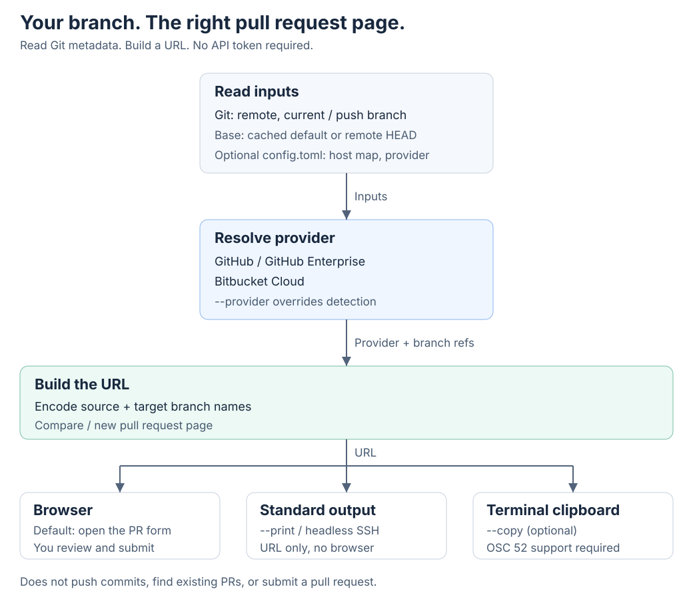

# prjump

Open the new pull request page for your current branch on GitHub or Bitbucket Cloud.

[](https://crates.io/crates/prjump)
[](https://github.com/KKamJi98/prjump/actions/workflows/ci.yml)
[](https://github.com/KKamJi98/prjump/blob/main/LICENSE)

`prj open` fills in the repository, source branch, and target. You review and submit.
The crate is **prjump**; the command is **`prj`**.


[Watch the MP4](https://raw.githubusercontent.com/KKamJi98/prjump/main/docs/demo/prjump.mp4)
- [Recreate the demo](https://github.com/KKamJi98/prjump/blob/main/docs/demo/README.md)

## Why prjump?

You have pushed a branch. Now you need the right page, not another trip through the repository UI.

| Without prj | With prj |
| --- | --- |
| Open the repository, find the branch, choose the base. | `prj open` uses your Git remote and branch. |
| Rebuild a compare URL when the target changes. | `prj open -t develop` selects the target. |
| Need the URL from an SSH session? Copy branch names by hand. | `prj open --print` prints it; `--copy` can copy through the terminal. |

No provider API token, GitHub CLI, or Python runtime required. Git must be on `PATH`.

## Install

```bash
# Homebrew (macOS, Linux)
brew install KKamJi98/tap/prj

# Cargo (Rust 1.85 or newer)
cargo install --locked prjump
```

**Prebuilt binaries:** download an archive from
[GitHub Releases](https://github.com/KKamJi98/prjump/releases/latest), extract it,
and put `prj` (Windows: `prj.exe`) on `PATH`.
Available for macOS (arm64, x86_64), Linux (arm64, x86_64; static musl), and Windows (x86_64).
Each release includes `SHA256SUMS` and build provenance attestations:

```bash
gh attestation verify <archive> --repo KKamJi98/prjump
```

<details>
<summary>Moving from the Python / PyPI version (0.2.x)</summary>

prjump 0.3.0 and later are written in Rust. The PyPI package remains at 0.2.2 and
receives no new releases. Install with Homebrew or Cargo above, then check which
binary your shell uses:

```bash
hash -r
type -a prj
prj --version
```

If you installed the old package with uv, remove that installation only after
confirming that the new binary is available:

```bash
uv tool uninstall prjump
hash -r
prj --version
```

Commands and flags are preserved. See the
[migration notes](https://github.com/KKamJi98/prjump/blob/main/docs/rust-migration.md)
for intentional behavior differences.

</details>

## Quick start

In your repository, push your branch as usual, then run:

```bash
prj open
```

That opens the **new pull request form**, not an existing PR, and does not submit it.
Use `--print` to preview the URL without opening a browser.

These are real outputs from the isolated demo: a synthetic `octo-demo/shop-api`
repository on `feature/cart`, with the default branch `main`. The `bitbucket` and
`alias` remotes are fixture names, not required remote names.

**GitHub: use the current branch and the remote's default target.**

```text
$ prj open --print
https://github.com/octo-demo/shop-api/compare/main...feature%2Fcart?quick_pull=1
```

**Bitbucket Cloud: choose another remote.**

```text
$ prj open --remote bitbucket --print
https://bitbucket.org/octo-demo/shop-api/pull-requests/new?source=feature%2Fcart&t=1
```

**Choose a target branch.**

```text
$ prj open -t develop --print
https://github.com/octo-demo/shop-api/compare/develop...feature%2Fcart?quick_pull=1
```

**Use an SSH host alias.** The fixture's `alias` remote uses
`git@demo-gh:octo-demo/shop-api.git`; the [configuration below](#configuration)
maps `demo-gh` to `github.com`.

```text
$ prj open --remote alias --print
https://github.com/octo-demo/shop-api/compare/main...feature%2Fcart?quick_pull=1
```

## How it works



- **Source:** the current branch and the name/remote Git would use to push it.
  `--source` overrides this. Missing upstreams, branches not pushed yet, and
  local commits ahead of the remote produce warnings, not an automatic push.
- **GitHub target:** `--target`, otherwise the cached remote HEAD, then
  `git ls-remote --symref`, then the first existing remote branch among
  `main`, `master`, `develop`, and `trunk`. Remote lookup times out after
  `PRJ_GIT_TIMEOUT` seconds (default 10; maximum 3600).
- **Forks:** when the push remote is another owner on the same GitHub host,
  `--remote upstream` can build an owner-qualified head (`owner:branch`).
- **Output:** open the browser by default, print with `--print`, or add
  `--copy` to copy the same URL through OSC 52. prj makes read-only Git queries;
  it does not push commits or call a PR-creation API.

## Commands and options

| Command | Action |
| --- | --- |
| `prj open [OPTIONS]` | Open the new pull request page. |
| `prj completions <SHELL>` | Print completions for `bash`, `elvish`, `fish`, `powershell`, or `zsh`. |
| `prj help [COMMAND]` | Print help, optionally for a subcommand. |
| `prj --version` | Print the program version. |
| `prj -h`, `prj --help` | Print help. |

Options for `prj open`:

| Option | Action / default |
| --- | --- |
| `--remote <REMOTE>` | Git remote name; default `origin`. |
| `-t, --target <TARGET>` | Target branch to merge into; GitHub auto-detects it when omitted. |
| `-s, --source <SOURCE>` | Source branch to merge from; defaults to the current branch / push target. |
| `--provider <PROVIDER>` | Override provider detection; `bitbucket` or `github`. |
| `--print` | Print the URL instead of opening the browser. |
| `--copy` | Also copy the URL to the terminal clipboard using OSC 52. |
| `-h, --help` | Print help. |

`prj open --help` and `prj completions --help` show the full CLI reference.

## Limits and caveats

- **Not an existing-PR finder.** prj always opens the compare / new pull request
  page. It does not look up an already-open PR.
- **GitHub and Bitbucket Cloud only.** GitHub Enterprise works with host mappings
  or `--provider github`. GitLab and Bitbucket Server / Data Center are
  [roadmap items](https://github.com/KKamJi98/prjump/blob/main/docs/ROADMAP.md).
- **Headless SSH sessions print the URL.** With `SSH_CONNECTION`, `SSH_CLIENT`,
  or `SSH_TTY` set, no `DISPLAY` / `WAYLAND_DISPLAY`, and no `$BROWSER`, prj
  prints instead of opening a browser. `--copy` requires terminal OSC 52
  support and permission; clipboard failures are warnings.
- **Bitbucket target selection is best effort.** `-t` adds `dest` to the URL;
  choose the destination manually if the Bitbucket UI ignores it. A cross-fork
  source must also be selected on the Bitbucket page.
- **Custom push refspecs and renamed forks are not resolved.** A mapping such as
  `refs/heads/*:refs/heads/me/*`, or a fork with a different repository name,
  may require manual source selection. See the
  [known gaps](https://github.com/KKamJi98/prjump/blob/main/docs/ROADMAP.md#known-gaps).
- **No implicit command:** `prj` alone prints help and exits 1. A detached HEAD
  needs `--source`.

## Shell completions and configuration

### Shell completions

Homebrew installs Bash, Zsh, and Fish completions. For a Cargo or archive install,
create the completion directory for your shell, then generate its script:

```bash
# Bash
mkdir -p ~/.local/share/bash-completion/completions
prj completions bash > ~/.local/share/bash-completion/completions/prj
```

```zsh
# Zsh: choose a writable directory on $fpath
prj completions zsh > "${fpath[1]}/_prj"
```

```fish
# Fish
mkdir -p ~/.config/fish/completions
prj completions fish > ~/.config/fish/completions/prj.fish
```

For PowerShell or Elvish, `prj completions powershell` or `prj completions elvish`
prints the script to load with your shell's completion setup.

### Configuration

For SSH aliases or custom server names, add host mappings to
`~/.config/prjump/config.toml`. prj does **not** read `~/.ssh/config` itself.

```toml
# A remote such as git@demo-gh:octo-demo/shop-api.git
[hosts."demo-gh"]
web_host = "github.com"

# A synthetic GitHub Enterprise host
[hosts."git.example.com"]
provider = "github"
web_host = "git.example.com:8443"
```

Config lookup order: `$PRJ_CONFIG`, then an absolute
`$XDG_CONFIG_HOME/prjump/config.toml`, then `~/.config/prjump/config.toml`
(`USERPROFILE` is the fallback if `HOME` is absent). An explicitly named
`PRJ_CONFIG` file must exist. `--provider` takes precedence over the file.

`$BROWSER` overrides the default browser on every supported platform. Each
colon-separated entry (semicolon on Windows) is a command name, not a command
with arguments; prj calls it with the URL as its only argument. If every entry
fails, it tries the platform default browser.

## Companion tools

- **[wtree](https://github.com/KKamJi98/wtree)** (`wt`): manage many git worktrees from one bare clone - create, sync, and clean them up.
- **[awspick](https://github.com/KKamJi98/aws-profile-pick)**: pick an AWS profile from a grouped, filterable list.
- **[prjump](https://github.com/KKamJi98/prjump)** (`prj`): jump from the current branch to the new pull request page on GitHub or Bitbucket Cloud.
- **[ssh-connector](https://github.com/KKamJi98/ssh-connector)**: pick a host from your `~/.ssh/config`, grouped, and connect.

## Contributing

Bug reports and focused pull requests are welcome. Reproduce problems with
synthetic repository names and remove credentials or private URLs from reports.
For development:

```bash
cargo fmt --all --check
cargo clippy --all-targets --locked -- -D warnings
cargo test --locked
```

The parity suite replays Python 0.2.2 behavior, with documented intentional
changes. See the [parity harness](https://github.com/KKamJi98/prjump/blob/main/scripts/parity/README.md),
[migration notes](https://github.com/KKamJi98/prjump/blob/main/docs/rust-migration.md),
and [roadmap](https://github.com/KKamJi98/prjump/blob/main/docs/ROADMAP.md).
The [demo source and isolated fixture](https://github.com/KKamJi98/prjump/blob/main/docs/demo/README.md)
are included so the recording can be reproduced.

## License

[MIT](https://github.com/KKamJi98/prjump/blob/main/LICENSE).
